# Ballast


**A one-voice kick drum synthesizer, rendered offline to WAV.** You write a kick
as a short, complete text patch. Ballast synthesizes a tonal body and an attack
at 16 times the sample rate, saturates their sum, and band-limits it once with
a frozen minimum-phase filter. The same patch gives the same samples, run after
run, and every WAV carries the patch that made it.

To hear the presets and explore the design, open
[`docs/index.html`](docs/index.html) in a browser. It is a single local page
and loads nothing from the network.

## Highlights

- **Deterministic.** Every sample is a pure function of the patch and its
  time, and the decimator ships as checksummed data, so the sound cannot drift
  with library versions.
- **Alias-free by construction.** The internal rate is 16 times the base rate,
  and a minimum-phase FIR rejects everything above half the base rate by at
  least 110 dB (115.7 dB measured), with 0–20 kHz flat to ±0.00002 dB.
- **The patch travels with the sound.** `ballast extract` returns the exact
  patch text from any rendered WAV, comments included.
- **Strict patches.** Every field is required, nothing is clamped, and every
  problem is reported with its field path.
- **Live audition.** Plays the exact render buffer, renders again on every
  save, and loops a bass line under the hits in tempo.
- **Sampler-ready.** The root key sits in the `smpl` chunk, and 16- and 24-bit
  PCM use seeded TPDF dither that never clips.
- **Tested.** The test suite checks every promise in this README in a few
  seconds.

## Quick start

Python 3.11 or later, with [uv](https://docs.astral.sh/uv/):

```
uv sync --extra audition                            # NumPy and SciPy, plus sounddevice (needs PortAudio)
uv run ballast init tight --tune F1 -o kick.toml    # a complete starting patch
uv run ballast audition kick.toml --watch --bpm 128 # plays it; renders again on every save
uv run ballast render kick.toml -o kick.wav         # a mono WAV with root note and patch
```

With pip instead: `pip install -e ".[audition]"`, then run `ballast` directly.

## Commands

```
ballast init tight --tune F1 -o kick.toml           # a complete starting patch (writes tune_hz = 43.654)
ballast audition kick.toml --watch --bpm 128        # plays the exact render buffer; re-renders on every save
ballast render kick.toml -o kick.wav                # mono float32 WAV with root note and embedded patch
ballast extract kick.wav -o kick.toml               # the exact patch text back from any rendered kick
ballast stretch kick.toml body.amp 0.6 -o kick.toml # rescale a curve's knot times after its peak
ballast tune kick.toml F#1 -o kick.toml             # retune to a note or a frequency
```

Without `-o`, `init`, `tune`, `stretch` and `extract` print the patch. On
Windows, prefer `-o` to shell redirection: PowerShell re-encodes what it
redirects. Such files still load, but the characters in their comments may
not survive.

The four presets are `tight`, `driven`, `round` and `long`.

For hardware samplers, `ballast render kick.toml -o kick.wav --format pcm24`
(or `pcm16`) writes integer PCM with triangular dither. The dither is seeded
from the patch, so the file is as reproducible as a float one, and exact
zeros stay zero. The peak is kept 2 LSB below full scale so the dither never
clips: peak mode lowers its target by that much, and a gain-mode render
above it is refused.

`ballast render` refuses to write a gain-mode render over full scale and
says by how much to lower `output.db`; `--allow-over` writes it anyway, as a
float file with overs. Nothing is ever clipped.

To hear the kick in context:

```
ballast audition kick.toml --watch --bpm 128 --with bass.wav
```

`--with` loops a bed under the hits, such as the track's bass line. It must
be a whole number of bars at `--bpm`, and it restarts on the tempo grid, so
it never drifts. Audition swaps in a new render at the next hit and keeps
playing the last valid buffer when an edit is invalid or over full scale.
It never resamples: it opens the device at the patch's sample rate or says
that it cannot. On Windows it plays through WASAPI, in exclusive mode when
the shared mixer runs at another rate.

## The patch

A patch is a complete TOML description of one kick. Every field is required
and the renderer has no defaults, so a future default can never change an
old patch. The parser rejects anything outside the valid domain, with every
problem and its field path, and never clamps or repairs.


```toml
schema = 1
seed = 1

[body]
tune_hz   = 50.0
level_db  = 0.0
h2        = 0.15            # second harmonic, 0 … 0.5
phase_deg = 0.0
phase_ref = "onset"         # "onset" | "tail"
pitch = [                   # ratio to tune_hz; starts at 0 ms, ends at 1
  { ms = 0.0,  ratio = 8.0 },
  { ms = 8.0,  ratio = 2.0 },
  { ms = 65.0, ratio = 1.0 },
]
amp = [                     # shape: 0 at both ends, highest point exactly 1
  { ms = 0.0,   gain = 0.0 },
  { ms = 0.2,   gain = 1.0 },
  { ms = 45.0,  gain = 0.75 },
  { ms = 160.0, gain = 0.2 },
  { ms = 350.0, gain = 0.0 },
]

[attack]
level_db      = -18.0
tone_hz       = 2000.0
noise_mix     = 0.6         # 0 = tone … 1 = noise
noise_band_hz = [700.0, 9000.0]
amp = [
  { ms = 0.0,  gain = 0.0 },
  { ms = 0.05, gain = 1.0 },
  { ms = 2.0,  gain = 0.25 },
  { ms = 8.0,  gain = 0.0 },
]

[drive]
db = 0.0                    # small-signal gain; 0 = bypass

[output]
sample_rate = 48000         # 44100, 48000, 88200 or 96000
mode        = "gain"        # "gain" | "peak"
db          = -6.0          # gain in dB, or peak target in dBFS
polarity    = 1
```

- **Curves** are monotone cubic Hermite (PCHIP) through their knots.
  Amplitude curves are shapes that start and end at 0 and peak at exactly 1;
  levels are separate gains in dB.
- **Body.** The body is `sin φ + h2 sin 2φ`. The pitch curve is a ratio to
  `tune_hz`, integrated exactly into phase. `phase_ref = "onset"` fixes the
  phase at the trigger; `"tail"` makes the body coincide exactly with the
  free-running sine at `tune_hz` from the last pitch knot on, whatever the
  sweep does before it.
- **Attack.** A sine at `tone_hz` and band-limited noise, mixed at constant
  power. The noise is a seeded continuous-time Gaussian process (SHAKE-256 →
  Rayleigh amplitudes and uniform phases on 1 Hz components). It is identical
  at every sample rate, and editing the band reweights the same noise.
- **Drive.** `drive.db` is the small-signal gain of the tanh saturator; 0 dB
  is exact bypass.



The valid domain:

| Quantity | Valid range |
|---|---|
| `tune_hz` | 20 – 1000 |
| body frequency at every pitch knot | 10 Hz – 20 kHz |
| `h2` | 0 – 0.5 |
| body and attack `level_db` | −inf (silence), or −60 – +24 |
| `drive.db` | 0 – 48 |
| `tone_hz` | 20 Hz – 20 kHz |
| `noise_mix` | 0 – 1 |
| `noise_band_hz` | 20 ≤ low < high ≤ 20 000 |
| knots per curve | pitch 2 – 32, amplitude 3 – 32 |
| knot spacing | ≥ 10 µs (compared on the decimal values as written) |
| body curves / attack curve | end by 8 s / by 1 s |
| `phase_deg` | 0 ≤ φ < 360 |
| output | 44.1, 48, 88.2 or 96 kHz; gain −60 – +24 dB; peak target −60 – 0 dBFS |
| `seed` | 0 – 2⁶³ − 1 |

## What a render reports

```
tuning   55.000 Hz, A1 +0.0 cents
length   240.0 ms source, 241.9 ms exported (11611 samples at 48000 Hz)
peak     -5.68 dBFS sample, -5.66 dBTP true
render   14 ms
```

The true peak is a 4× oversampled estimate of the peak between samples.

## How it renders


    x(t) = b(t) + a(t),    y(t) = S_α(x(t)),    out[m] = p · g_out · Σ_k h[k] · y((mK − k) / F)

Everything before the decimator is a pure function of time, so a render
depends only on the patch, the renderer version and the frozen filter.

- **Rates.** The internal rate is 16 times the base rate: 705.6 kHz for the
  44.1 kHz family, 768 kHz for 48 kHz. The 88.2 and 96 kHz exports reuse
  their family's rate and filter with factor 8, so a 96 kHz file equals the
  48 kHz file with the in-between samples filled in, bit for bit.
- **Decimator.** One frozen minimum-phase FIR per family. It passes 0–20 kHz
  within 0.001 dB, attenuates at least 110 dB from base/2 upward, and its
  taps sum to exactly 1. It ships as data with a SHA-256 checksum, so the
  sound cannot drift with SciPy versions.
- **Evaluation.** The internal signal is computed in blocks of 2¹⁵ samples
  aligned to the trigger, each source only over its own support, and
  decimated in parallel chunks on every core. No block, chunk or thread
  changes a sample, and a longer render never changes earlier ones.
- **Output.** Output gain or peak normalization, then polarity, then one
  conversion to float32, or one quantization to PCM with seeded TPDF dither.
- **File.** Our own RIFF writer adds a `smpl` chunk, so samplers map the root
  key from `tune_hz`, and a private `blst` chunk with the patch text,
  renderer version, decimator checksum and dependency versions (and, for
  PCM, the dither's key and seed).


## Development

```
uv sync --all-extras             # the package, audition, pytest and ruff
uv run pytest                    # the test suite
uv run ruff check                # lint
uv run ruff format --check       # formatting
uv run python docs/build.py      # rebuild the showcase: runs the tests, renders the sounds, draws the figures
```

The tests check properties rather than stored hashes, so they hold on any
platform: rendering in blocks or in parallel never changes a sample, a 96 kHz
render fills in the 48 kHz one bit for bit, the decimators meet their
specification, every patch rule reports its exact message and path, and
`extract` returns the patch byte for byte.

| Path | Responsibility |
|---|---|
| `src/ballast/patch.py` | the schema, declared once on the dataclass fields; parsing, canonical TOML, edits, tuning |
| `src/ballast/curve.py` | monotone cubic Hermite curves with exact integrals |
| `src/ballast/noise.py` | seeded continuous-time noise, and the PCM dither |
| `src/ballast/voice.py` | body, attack and saturator as pure functions of time, evaluated in blocks |
| `src/ballast/render.py` | rates, frozen decimators, parallel decimation, output stage, report, export |
| `src/ballast/wav.py` | the RIFF writer, and the chunk reader behind `extract` |
| `src/ballast/audition.py` | hits, bed, watcher and playback |
| `src/ballast/cli.py` | the commands |
| `src/ballast/data/` | the two decimators and the four presets |
| `tests/` | the test suite, one file per module |
| `docs/` | the showcase page, its figures and sounds, and `build.py`, which makes them |
