# Design

Ballast computes one kick as a pure function of time, at 16 times the sample
rate, and band-limits it once.

    x(t) = b(t) + a(t),    z = C(S_α(x)),    out[m] = p · g_out · Σ_k h[k] · z[mK − k]

Here b is the body, a the attack, S_α the saturator and C the optional low
cut, all at the internal rate F; h is the frozen decimator of the sample
rate's family, K the decimation factor, g_out the output gain and p the
polarity.

- [The body](#the-body)
- [Curves](#curves)
- [The attack](#the-attack)
- [The saturator](#the-saturator)
- [The low cut](#the-low-cut)
- [Rates and the decimator](#rates-and-the-decimator)
- [The output stage](#the-output-stage)
- [Evaluation](#evaluation)
- [Reproducibility](#reproducibility)
- [Audition](#audition)
- [Code map](#code-map)

## The body

The body is a sine with a second harmonic, under an amplitude shape A_b:

    b(t) = g_b / √(1 + h2²) · A_b(t) · (sin φ(t) + h2 sin 2φ(t))

The factor 1 / √(1 + h2²) keeps the body's power independent of `h2`, and
sin φ + h2 sin 2φ = sin φ (1 + 2 h2 cos φ) adds no zero crossings while
h2 ≤ ½.

The phase integrates the frequency f(t) = f₀ R(t), where R is the pitch
curve. Ballast integrates the cubic segments of R in closed form rather than
summing samples, so the phase carries no accumulated error and does not depend
on the sample rate:

    φ(t) = φ₀ + 2π f₀ τ(t),    τ(t) = ∫₀ᵗ R

With `phase_ref = "tail"`, τ is measured from the end instead: τ(t) = t from
the last pitch knot t_n on, and τ(t) = t_n − ∫ₜ^{t_n} R before it. The tail is
then exactly the free-running sine at f₀ with phase φ₀, whatever the sweep
does, and the integral from t to t_n is computed on its own so it stays exact
as t approaches t_n.

A spectrogram shows the sweep over a whole kick, with the attack's short burst
at its start; the [preset gallery](presets.md) has one for every preset.

## Curves

Every curve is a monotone cubic Hermite interpolant (PCHIP) through its knots.
Interior slopes are the weighted harmonic mean of the neighboring secants
(Fritsch–Butland), or zero where the secants differ in sign or one of them is
zero; end slopes use the shape-preserving three-point rule. Every slope this produces keeps both
normalized slopes of each segment within the Fritsch–Carlson region, so each
segment is monotone and stays between its two knot values: a curve never
overshoots.

Amplitude shapes fix both end slopes to zero, so they leave and join silence
smoothly; the pitch curve fixes its last slope to zero, so it lands on the
note without a kink. Each curve also stores the integral of every segment from
both ends, which gives the exact phase above.

## The attack

The attack mixes a sine and noise at constant power, under its own amplitude
shape A_a:

    a(t) = g_a · A_a(t) · (cos(πm/2) sin(2π f_t t) + sin(πm/2) n(t))

where m is `noise_mix` and f_t is `tone_hz`; at m = 0 and m = 1 the weights
are exactly 1 and 0.

The noise is a seeded continuous-time Gaussian process:

    n(t) = γ Σ_{k=1}^{20000} |H(f_k)| ρ_k cos(2π f_k t + θ_k),    f_k = k Hz

SHAKE-256, keyed by `ballast/noise/v1` and the seed, gives 16 bytes per
component. They become two 53-bit uniforms and, by Box–Muller, a Rayleigh
amplitude ρ_k and a uniform phase θ_k, so each component is a circular
Gaussian and n(t) is exactly Gaussian at every t. |H| is a pair of
second-order Butterworth skirts with their half-power points at the band
edges, and γ makes the expected power ½, that of a unit sine.

Because the noise is a function of t, it is the same signal at every sample
rate, and because the shaping only reweights components, editing the band
keeps the same noise. It repeats every second, so Ballast computes one second
of it per internal rate with a single inverse real FFT.

## The saturator

    S_α(x) = tanh(αx) / tanh α,    α / tanh α = 10^(db/20)

The saturator keeps full scale at full scale, S_α(±1) = ±1 exactly, and its
small-signal gain is `drive.db`. α solves that equation numerically; at 0 dB,
S is the identity, an exact bypass. It is computed as sign(x) · tanh(α|x|) /
tanh α, so it is odd by construction.

## The low cut

`output.low_cut_hz` adds a second-order Butterworth high-pass, 12 dB per
octave with its half-power point at the corner, after the saturator. Ballast
derives its coefficients in closed form, by the bilinear transform with the
corner prewarped, rather than calling a filter design routine, so they cannot
drift with SciPy versions. It filters the internal signal in one causal pass:
every rate of a family shares the result, and a longer render still never
changes earlier samples. At 0 the filter is not there at all.

A high-pass shifts the phase of low frequencies, so with `phase_ref = "tail"`
the tail is the free-running sine before the low cut, and the same sine
shifted by the filter's constant phase at f₀ after it.

## Rates and the decimator

| Sample rate | Internal rate F | Factor K | Decimator |
|---|---|---|---|
| 44.1 kHz | 705.6 kHz | 16 | 44.1 kHz family, 2593 taps |
| 88.2 kHz | 705.6 kHz | 8 | 44.1 kHz family, 2593 taps |
| 176.4 kHz | 705.6 kHz | 4 | 44.1 kHz family, 2593 taps |
| 48 kHz | 768 kHz | 16 | 48 kHz family, 1447 taps |
| 96 kHz | 768 kHz | 8 | 48 kHz family, 1447 taps |
| 192 kHz | 768 kHz | 4 | 48 kHz family, 1447 taps |

Each family has one minimum-phase FIR, frozen and shipped as data with a
SHA-256 checksum that Ballast verifies before use, so the filter cannot drift
with SciPy versions. Both pass 0–20 kHz within ±0.00002 dB, attenuate
everything from half the base rate up by at least 115.7 dB, and have taps that
sum to exactly 1. Minimum phase puts all the ringing after the transient, none
before it.

A 96 or 192 kHz render uses the same internal signal and filter as the 48 kHz
one with a half or a quarter of the factor, so it is the 48 kHz file with the
in-between samples filled in, bit for bit; 88.2 and 176.4 kHz relate to
44.1 kHz the same way. The higher rates therefore carry the same audio band,
up to 20 kHz, with no new content above it.

The file keeps the whole filter tail: a render is N internal samples, with N
the number of n such that n / F ≤ T, and out has ⌊(N + L − 2) / K⌋ + 1
samples for L taps.

## The output stage

In `gain` mode the output is multiplied by 10^(db/20). In `peak` mode it is
scaled so its highest sample reaches the target, capped at the format's
ceiling. In `true-peak` mode it is scaled so its true peak, estimated with 4×
oversampling, reaches the target, or its highest sample reaches the ceiling,
whichever comes first; the estimate is linear, so one scale does it. Then the
polarity applies, and the result is converted once to float32.

PCM exports have a ceiling 2 LSB below full scale. They add TPDF dither of
±1 LSB, the difference of two 32-bit uniforms from SHAKE-256 keyed by
`ballast/dither/v1` and the seed, and round. A render within the ceiling stays
within range after dither, and exact zeros stay zero.

Nothing trims or fades, and only the low cut, when it is on, high-passes or
removes DC.

## Evaluation

The internal signal is computed in blocks of 2¹⁵ samples aligned to the
trigger, which bounds memory; each source is evaluated only over its own
support. The decimator then runs in parallel chunks of 2048 outputs. Each
output of the decimator is one fixed sum over its own inputs, and each chunk
starts on the factor's grid with every input its outputs need, so the chunks
match a single pass bit for bit. Neither the blocks nor the threads change a
sample, and because the filter is causal, a longer render never changes
earlier samples. On a 12-core laptop, the 1.45 s `long` preset renders in
about 80 ms.

## Reproducibility

The renderer is deterministic: no randomness, no state, and no dependence on
block sizes or thread counts. The same patch on the same platform, with the
same NumPy and SciPy versions, renders the same samples bit for bit, every
time. Each WAV records the renderer version, the decimator checksum, the
platform and the library versions next to the patch.

Across platforms or library versions, the elementary functions (sine, tanh,
logarithm) and the FFT may round their last bit differently, so a few samples
may differ in their last bit, far below audibility. The inputs that define the
sound are exact and portable: the patch, the SHAKE-256 bytes behind the noise
and the dither, and the filter taps.

## Audition

Audition reuses the renderer and adds four small parts:

- **Hits** mixes the output block by block. Every sound is an unchoked
  one-shot: each hit plays the current buffer to its end, and loop k of the bed
  plays until loop k + 1 starts. Hits and loops start on the same beat
  rounding, so the bed never drifts from the kick, and sounds are summed in
  order of their start, so the block size never changes the mix.
- **Watcher** polls the patch file every 0.1 s and reads it again when its
  size or modification time changes.
- **The stream callback** fills each block from Hits and counts the device's
  underflows; the play loop reports them, since the audio thread must never
  print.
- **The play loop** renders each new version and polls once more: if the file
  changed during the render, the result is dropped and the newer version
  rendered next. Only a valid render that fits full scale replaces the buffer,
  at the next hit.

## Code map

| Module | Responsibility |
|---|---|
| `patch.py` | the schema, declared once on the dataclass fields; parsing, canonical TOML, edits, tuning |
| `curve.py` | monotone cubic Hermite curves with exact integrals |
| `noise.py` | the seeded continuous-time noise, and the PCM dither |
| `voice.py` | body, attack and saturator as pure functions of time, evaluated in blocks |
| `render.py` | rates, frozen decimators, parallel decimation, output stage, report, export |
| `wav.py` | the RIFF writer, and the chunk reader behind `extract` |
| `audition.py` | hits, bed, watcher and playback |
| `cli.py` | the commands |
| `data/` | the two decimators and the four presets |
