# Presets

<!-- Generated by docs/build.py from the shipped presets: edit the script, not this page. -->

Ballast ships four presets: complete patches to start from, tuned with `--tune` to your track.

```
ballast init round --tune F1 -o kick.toml
```

| Preset | Tuning | Length | Pitch drop | Drive | Peak | Sound |
|---|---|---|---|---|---|---|
| [`tight`](#tight) | 55 Hz, A1 | 240 ms | 7× to the note in 40 ms | 6 dB | −5.72 dBFS | [tight.wav](audio/tight.wav) |
| [`driven`](#driven) | 50 Hz, G1 +35.0 cents | 400 ms | 6× to the note in 55 ms | 21 dB | −8.84 dBFS | [driven.wav](audio/driven.wav) |
| [`round`](#round) | 48.999 Hz, G1 | 600 ms | 4.5× to the note in 90 ms | 3 dB | −5.91 dBFS | [round.wav](audio/round.wav) |
| [`long`](#long) | 41.203 Hz, E1 | 1450 ms | 3.5× to the note in 70 ms | 2 dB | −5.97 dBFS | [long.wav](audio/long.wav) |


Every preset renders at 48 kHz in `gain` mode with no low cut, and its sound here is 16-bit PCM. Their figures share every scale but time, so the presets compare at a glance.

## tight

Short and punchy, for a busy mix: a fast pitch drop, a bright click of tone and noise, and a body that is gone in a quarter of a second.

[Listen to tight.wav](audio/tight.wav) · start from it with `ballast init tight`




<details>
<summary>The tight patch</summary>

```toml
schema = 3
seed = 1

[body]
tune_hz   = 55.0
level_db  = 0.0
h2        = 0.15            # second harmonic, 0 … 0.5
phase_deg = 0.0
phase_ref = "onset"         # "onset" | "tail"
pitch = [                   # ratio to tune_hz; starts at 0 ms, ends at 1
  { ms = 0.0,  ratio = 7.0 },
  { ms = 6.0,  ratio = 2.2 },
  { ms = 40.0, ratio = 1.0 },
]
amp = [                     # shape: 0 at both ends, highest point exactly 1
  { ms = 0.0,   gain = 0.0 },
  { ms = 0.25,  gain = 1.0 },
  { ms = 30.0,  gain = 0.8 },
  { ms = 100.0, gain = 0.35 },
  { ms = 180.0, gain = 0.08 },
  { ms = 240.0, gain = 0.0 },
]

[attack]
level_db      = -16.0
tone_hz       = 2500.0
noise_mix     = 0.55        # 0 = tone … 1 = noise
noise_band_hz = [1200.0, 8000.0]
pitch = [                   # ratio to tone_hz; starts at 0 ms, ends at 1
  { ms = 0.0, ratio = 1.0 },
]
amp = [
  { ms = 0.0,  gain = 0.0 },
  { ms = 0.08, gain = 1.0 },
  { ms = 1.5,  gain = 0.35 },
  { ms = 6.0,  gain = 0.0 },
]

[drive]
db        = 6.0             # small-signal gain; 0 = bypass
asymmetry = 0.0             # even harmonics, 0 … 1
mix       = 1.0             # 0 = dry … 1 = driven

[clip]
db      = 0.0               # off the peaks; 0 = off
knee_db = 0.0               # 0 = hard … 6 = soft

[output]
sample_rate = 48000
low_cut_hz  = 0.0           # high-pass, 12 dB/oct; 0 = off
mode        = "gain"        # "gain" | "peak" | "true-peak"
db          = -6.0          # gain in dB, or peak target
polarity    = 1
```

</details>

## driven

Dense and saturated: heavy drive squares the body off and adds odd harmonics, a strong second harmonic adds even ones, and the output sits lower to leave room for them.

[Listen to driven.wav](audio/driven.wav) · start from it with `ballast init driven`


<details>
<summary>The driven patch</summary>

```toml
schema = 3
seed = 1

[body]
tune_hz   = 50.0
level_db  = 0.0
h2        = 0.25            # second harmonic, 0 … 0.5
phase_deg = 0.0
phase_ref = "onset"         # "onset" | "tail"
pitch = [                   # ratio to tune_hz; starts at 0 ms, ends at 1
  { ms = 0.0,  ratio = 6.0 },
  { ms = 8.0,  ratio = 2.0 },
  { ms = 55.0, ratio = 1.0 },
]
amp = [                     # shape: 0 at both ends, highest point exactly 1
  { ms = 0.0,   gain = 0.0 },
  { ms = 0.3,   gain = 1.0 },
  { ms = 50.0,  gain = 0.8 },
  { ms = 180.0, gain = 0.45 },
  { ms = 320.0, gain = 0.12 },
  { ms = 400.0, gain = 0.0 },
]

[attack]
level_db      = -20.0
tone_hz       = 3000.0
noise_mix     = 0.5         # 0 = tone … 1 = noise
noise_band_hz = [800.0, 10000.0]
pitch = [                   # ratio to tone_hz; starts at 0 ms, ends at 1
  { ms = 0.0, ratio = 1.0 },
]
amp = [
  { ms = 0.0,  gain = 0.0 },
  { ms = 0.05, gain = 1.0 },
  { ms = 2.0,  gain = 0.3 },
  { ms = 7.0,  gain = 0.0 },
]

[drive]
db        = 21.0            # small-signal gain; 0 = bypass
asymmetry = 0.0             # even harmonics, 0 … 1
mix       = 1.0             # 0 = dry … 1 = driven

[clip]
db      = 0.0               # off the peaks; 0 = off
knee_db = 0.0               # 0 = hard … 6 = soft

[output]
sample_rate = 48000
low_cut_hz  = 0.0           # high-pass, 12 dB/oct; 0 = off
mode        = "gain"        # "gain" | "peak" | "true-peak"
db          = -9.0          # gain in dB, or peak target
polarity    = 1
```

</details>

## round

Warm and rounded: a gentle pitch drop, a soft, low click, and a body that rings for longer.

[Listen to round.wav](audio/round.wav) · start from it with `ballast init round`


<details>
<summary>The round patch</summary>

```toml
schema = 3
seed = 1

[body]
tune_hz   = 48.999
level_db  = 0.0
h2        = 0.08            # second harmonic, 0 … 0.5
phase_deg = 0.0
phase_ref = "onset"         # "onset" | "tail"
pitch = [                   # ratio to tune_hz; starts at 0 ms, ends at 1
  { ms = 0.0,  ratio = 4.5 },
  { ms = 12.0, ratio = 1.7 },
  { ms = 90.0, ratio = 1.0 },
]
amp = [                     # shape: 0 at both ends, highest point exactly 1
  { ms = 0.0,   gain = 0.0 },
  { ms = 0.6,   gain = 1.0 },
  { ms = 60.0,  gain = 0.85 },
  { ms = 220.0, gain = 0.42 },
  { ms = 420.0, gain = 0.12 },
  { ms = 600.0, gain = 0.0 },
]

[attack]
level_db      = -28.0
tone_hz       = 900.0
noise_mix     = 0.3         # 0 = tone … 1 = noise
noise_band_hz = [300.0, 4000.0]
pitch = [                   # ratio to tone_hz; starts at 0 ms, ends at 1
  { ms = 0.0, ratio = 1.0 },
]
amp = [
  { ms = 0.0,  gain = 0.0 },
  { ms = 0.4,  gain = 1.0 },
  { ms = 3.0,  gain = 0.3 },
  { ms = 12.0, gain = 0.0 },
]

[drive]
db        = 3.0             # small-signal gain; 0 = bypass
asymmetry = 0.0             # even harmonics, 0 … 1
mix       = 1.0             # 0 = dry … 1 = driven

[clip]
db      = 0.0               # off the peaks; 0 = off
knee_db = 0.0               # 0 = hard … 6 = soft

[output]
sample_rate = 48000
low_cut_hz  = 0.0           # high-pass, 12 dB/oct; 0 = off
mode        = "gain"        # "gain" | "peak" | "true-peak"
db          = -6.0          # gain in dB, or peak target
polarity    = 1
```

</details>

## long

An 808-style kick with a long tail, to play as a bassline with `ballast multisample`. Its tail is locked to the note with `phase_ref = "tail"`, so editing the sweep never moves it.

[Listen to long.wav](audio/long.wav) · start from it with `ballast init long`


<details>
<summary>The long patch</summary>

```toml
schema = 3
seed = 1

[body]
tune_hz   = 41.203
level_db  = 0.0
h2        = 0.05            # second harmonic, 0 … 0.5
phase_deg = 0.0
phase_ref = "tail"          # "onset" | "tail"
pitch = [                   # ratio to tune_hz; starts at 0 ms, ends at 1
  { ms = 0.0,  ratio = 3.5 },
  { ms = 15.0, ratio = 1.6 },
  { ms = 70.0, ratio = 1.0 },
]
amp = [                     # shape: 0 at both ends, highest point exactly 1
  { ms = 0.0,    gain = 0.0 },
  { ms = 1.0,    gain = 1.0 },
  { ms = 90.0,   gain = 0.9 },
  { ms = 310.0,  gain = 0.285 },
  { ms = 530.0,  gain = 0.09 },
  { ms = 750.0,  gain = 0.0285 },
  { ms = 970.0,  gain = 0.009 },
  { ms = 1190.0, gain = 0.00285 },
  { ms = 1450.0, gain = 0.0 },
]

[attack]
level_db      = -24.0
tone_hz       = 1500.0
noise_mix     = 0.4         # 0 = tone … 1 = noise
noise_band_hz = [500.0, 6000.0]
pitch = [                   # ratio to tone_hz; starts at 0 ms, ends at 1
  { ms = 0.0, ratio = 1.0 },
]
amp = [
  { ms = 0.0, gain = 0.0 },
  { ms = 0.2, gain = 1.0 },
  { ms = 2.5, gain = 0.3 },
  { ms = 9.0, gain = 0.0 },
]

[drive]
db        = 2.0             # small-signal gain; 0 = bypass
asymmetry = 0.0             # even harmonics, 0 … 1
mix       = 1.0             # 0 = dry … 1 = driven

[clip]
db      = 0.0               # off the peaks; 0 = off
knee_db = 0.0               # 0 = hard … 6 = soft

[output]
sample_rate = 48000
low_cut_hz  = 0.0           # high-pass, 12 dB/oct; 0 = off
mode        = "gain"        # "gain" | "peak" | "true-peak"
db          = -6.0          # gain in dB, or peak target
polarity    = 1
```

</details>
