# Presets

<!-- Generated by docs/build.py from the shipped presets: edit the script, not this page. -->

Ballast ships eleven presets, complete patches to start from, tuned with `--tune` to your track: four shapes; three kicks for house, tech house and trance, with the drive's warmth, the clipper, brightness, the zap, the sub and the EQ; and four along the line from machine to band, from a sampled drum machine to an acoustic drum played in a room.

```
ballast init round --tune F1 -o kick.toml
```

| Preset | Tuning | Length | Pitch drop | Drive | Loudness | Sound |
|---|---|---|---|---|---|---|
| [`tech-house`](#tech-house) | 65.406 Hz, C2 | 230 ms | 6× to the note in 25 ms | 18 dB | −9.2 LUFS | [tech-house.wav](audio/tech-house.wav) |
| [`tight`](#tight) | 55 Hz, A1 | 240 ms | 7× to the note in 40 ms | 6 dB | −13.4 LUFS | [tight.wav](audio/tight.wav) |
| [`fat`](#fat) | 55 Hz, A1 | 250 ms | 1.4× to the note in 25 ms | 18 dB | −8.8 LUFS | [fat.wav](audio/fat.wav) |
| [`sampled`](#sampled) | 55 Hz, A1 | 320 ms | 4.5× to the note in 40 ms | 10 dB | −8.3 LUFS | [sampled.wav](audio/sampled.wav) |
| [`house`](#house) | 55 Hz, A1 | 330 ms | 5× to the note in 45 ms | 14 dB | −8.2 LUFS | [house.wav](audio/house.wav) |
| [`driven`](#driven) | 50 Hz, G1 +35.0 cents | 400 ms | 6× to the note in 55 ms | 21 dB | −6.8 LUFS | [driven.wav](audio/driven.wav) |
| [`trance`](#trance) | 48.999 Hz, G1 | 480 ms | 6× to the note in 60 ms | 12 dB | −9.5 LUFS | [trance.wav](audio/trance.wav) |
| [`round`](#round) | 48.999 Hz, G1 | 600 ms | 4.5× to the note in 90 ms | 3 dB | −11.3 LUFS | [round.wav](audio/round.wav) |
| [`kit`](#kit) | 55 Hz, A1 | 1356 ms | 1.12× to the note in 40 ms | 3 dB | −15.2 LUFS | [kit.wav](audio/kit.wav) |
| [`long`](#long) | 41.203 Hz, E1 | 1450 ms | 3.5× to the note in 70 ms | 2 dB | −12.0 LUFS | [long.wav](audio/long.wav) |
| [`deep`](#deep) | 48.999 Hz, G1 | 1920 ms | 2.5× to the note in 60 ms | 8 dB | −11.2 LUFS | [deep.wav](audio/deep.wav) |


Every preset renders at 48 kHz with its true peak at −1 dBTP, and its sound here is 16-bit PCM. Loudness is the highest momentary loudness, as `ballast render` reports it. Their figures share every scale but time, so the presets compare at a glance.

## tech-house

Short and knocky, in C2: a fast drop, a bright, noisy tick, a body brightened to carry on small speakers, a 4 dB knock at 200 Hz, and hard drive and clipping. Gone in under a quarter of a second.

[Listen to tech-house.wav](audio/tech-house.wav) · start from it with `ballast init tech-house`




<details>
<summary>The tech-house patch</summary>

```toml
schema = 3
seed = 1

[body]
tune_hz   = 65.406
level_db  = 0.0
h2        = 0.05            # second harmonic, 0 … 0.5
bright_hz = 400.0           # harmonics fade above; 0 = sine
phase_deg = 0.0
phase_ref = "onset"         # "onset" | "tail"
pitch = [                   # ratio to tune_hz; starts at 0 ms, ends at 1
  { ms = 0.0,  ratio = 6.0 },
  { ms = 2.5,  ratio = 2.0 },
  { ms = 25.0, ratio = 1.0 },
]
amp = [                     # shape: 0 at both ends, highest point exactly 1
  { ms = 0.0,   gain = 0.0 },
  { ms = 0.2,   gain = 1.0 },
  { ms = 25.0,  gain = 0.75 },
  { ms = 90.0,  gain = 0.3 },
  { ms = 180.0, gain = 0.06 },
  { ms = 230.0, gain = 0.0 },
]
modes = []                  # ratio to the body, dB re its sine, ms to fall 60 dB

[attack]
level_db      = -12.0
tone_hz       = 3500.0
noise_mix     = 0.8         # 0 = tone … 1 = noise
noise_band_hz = [2500.0, 12000.0]
pitch = [                   # ratio to tone_hz; starts at 0 ms, ends at 1
  { ms = 0.0, ratio = 1.0 },
]
amp = [
  { ms = 0.0,  gain = 0.0 },
  { ms = 0.05, gain = 1.0 },
  { ms = 0.8,  gain = 0.3 },
  { ms = 3.0,  gain = 0.0 },
]

[drive]
db        = 18.0            # small-signal gain; 0 = bypass
asymmetry = 0.5             # even harmonics, 0 … 1
mix       = 1.0             # 0 = dry … 1 = driven

[eq]
low_hz    = 80.0            # low shelf
low_db    = 0.0             # 0 = off
bell_hz   = 200.0           # bell
bell_db   = 4.0             # 0 = off
bell_q    = 1.5             # 0.3 = wide … 10 = narrow
high_hz   = 8000.0          # high shelf
high_db   = 0.0             # 0 = off
cutoff_hz = 0.0             # low-pass, 12 dB/oct; 0 = off
resonance = 0.707           # Q: 0.707 = flat … 10

[clip]
db      = 4.0               # off the peaks; 0 = off
knee_db = 3.0               # 0 = hard … 6 = soft

[output]
sample_rate = 48000
low_cut_hz  = 0.0           # high-pass, 12 dB/oct; 0 = off
mode        = "true-peak"   # "gain" | "peak" | "true-peak"
db          = -1.0          # gain in dB, or peak target
polarity    = 1
```

</details>

## tight

Short and punchy, for a busy mix: a fast pitch drop, a bright click of tone and noise, and a body that is gone in a quarter of a second.

[Listen to tight.wav](audio/tight.wav) · start from it with `ballast init tight`


<details>
<summary>The tight patch</summary>

```toml
schema = 3
seed = 1

[body]
tune_hz   = 55.0
level_db  = 0.0
h2        = 0.15            # second harmonic, 0 … 0.5
bright_hz = 0.0             # harmonics fade above; 0 = sine
phase_deg = 0.0
phase_ref = "onset"         # "onset" | "tail"
pitch = [                   # ratio to tune_hz; starts at 0 ms, ends at 1
  { ms = 0.0,  ratio = 7.0 },
  { ms = 6.0,  ratio = 2.2 },
  { ms = 40.0, ratio = 1.0 },
]
amp = [                     # shape: 0 at both ends, highest point exactly 1
  { ms = 0.0,   gain = 0.0 },
  { ms = 0.25,  gain = 1.0 },
  { ms = 30.0,  gain = 0.8 },
  { ms = 100.0, gain = 0.35 },
  { ms = 180.0, gain = 0.08 },
  { ms = 240.0, gain = 0.0 },
]
modes = []                  # ratio to the body, dB re its sine, ms to fall 60 dB

[attack]
level_db      = -16.0
tone_hz       = 2500.0
noise_mix     = 0.55        # 0 = tone … 1 = noise
noise_band_hz = [1200.0, 8000.0]
pitch = [                   # ratio to tone_hz; starts at 0 ms, ends at 1
  { ms = 0.0, ratio = 1.0 },
]
amp = [
  { ms = 0.0,  gain = 0.0 },
  { ms = 0.08, gain = 1.0 },
  { ms = 1.5,  gain = 0.35 },
  { ms = 6.0,  gain = 0.0 },
]

[drive]
db        = 6.0             # small-signal gain; 0 = bypass
asymmetry = 0.0             # even harmonics, 0 … 1
mix       = 1.0             # 0 = dry … 1 = driven

[eq]
low_hz    = 80.0            # low shelf
low_db    = 0.0             # 0 = off
bell_hz   = 200.0           # bell
bell_db   = 0.0             # 0 = off
bell_q    = 1.0             # 0.3 = wide … 10 = narrow
high_hz   = 8000.0          # high shelf
high_db   = 0.0             # 0 = off
cutoff_hz = 0.0             # low-pass, 12 dB/oct; 0 = off
resonance = 0.707           # Q: 0.707 = flat … 10

[clip]
db      = 0.0               # off the peaks; 0 = off
knee_db = 0.0               # 0 = hard … 6 = soft

[output]
sample_rate = 48000
low_cut_hz  = 0.0           # high-pass, 12 dB/oct; 0 = off
mode        = "true-peak"   # "gain" | "peak" | "true-peak"
db          = -1.0          # gain in dB, or peak target
polarity    = 1
```

</details>

## fat

One player through effects: a drum's modes saturated hard, with even harmonics, and clipped into one dry, thick thud. Its [play] section plays it lightly: small repeats and a shallow velocity range.

[Listen to fat.wav](audio/fat.wav) · start from it with `ballast init fat`




<details>
<summary>The fat patch</summary>

```toml
schema = 3
seed = 1

[body]
tune_hz   = 55.0
level_db  = 0.0
h2        = 0.0             # second harmonic, 0 … 0.5
bright_hz = 0.0             # harmonics fade above; 0 = sine
phase_deg = 0.0
phase_ref = "onset"         # "onset" | "tail"
pitch = [                   # ratio to tune_hz; starts at 0 ms, ends at 1
  { ms = 0.0,  ratio = 1.4 },
  { ms = 25.0, ratio = 1.0 },
]
amp = [                     # shape: 0 at both ends, highest point exactly 1
  { ms = 0.0,   gain = 0.0 },
  { ms = 0.4,   gain = 1.0 },
  { ms = 30.0,  gain = 0.7 },
  { ms = 120.0, gain = 0.25 },
  { ms = 200.0, gain = 0.05 },
  { ms = 250.0, gain = 0.0 },
]
modes = [                   # ratio to the body, dB re its sine, ms to fall 60 dB
  { ratio = 1.594, db = -5.0,  decay_ms = 140.0 },
  { ratio = 2.136, db = -9.0,  decay_ms = 90.0 },
  { ratio = 2.296, db = -12.0, decay_ms = 80.0 },
  { ratio = 2.653, db = -14.0, decay_ms = 60.0 },
  { ratio = 7.3,   db = -16.0, decay_ms = 35.0 },
]

[attack]
level_db      = -16.0
tone_hz       = 2200.0
noise_mix     = 1.0         # 0 = tone … 1 = noise
noise_band_hz = [1200.0, 7000.0]
pitch = [                   # ratio to tone_hz; starts at 0 ms, ends at 1
  { ms = 0.0, ratio = 1.0 },
]
amp = [
  { ms = 0.0, gain = 0.0 },
  { ms = 0.1, gain = 1.0 },
  { ms = 1.0, gain = 0.3 },
  { ms = 4.0, gain = 0.0 },
]

[drive]
db        = 18.0            # small-signal gain; 0 = bypass
asymmetry = 0.6             # even harmonics, 0 … 1
mix       = 1.0             # 0 = dry … 1 = driven

[eq]
low_hz    = 80.0            # low shelf
low_db    = 0.0             # 0 = off
bell_hz   = 180.0           # bell
bell_db   = 2.0             # 0 = off
bell_q    = 1.0             # 0.3 = wide … 10 = narrow
high_hz   = 8000.0          # high shelf
high_db   = 0.0             # 0 = off
cutoff_hz = 3000.0          # low-pass, 12 dB/oct; 0 = off
resonance = 1.0             # Q: 0.707 = flat … 10

[clip]
db      = 5.0               # off the peaks; 0 = off
knee_db = 4.0               # 0 = hard … 6 = soft

[output]
sample_rate = 48000
low_cut_hz  = 0.0           # high-pass, 12 dB/oct; 0 = off
mode        = "true-peak"   # "gain" | "peak" | "true-peak"
db          = -1.0          # gain in dB, or peak target
polarity    = 1

[play]
soft_db       = -14.0       # the softest hit's level
soft_click_db = -4.0        # and its click's, further
soft_punch    = 0.7         # of the pitch drop it keeps
spread        = 0.3         # how much each repeat differs
```

</details>

## sampled

The machine end: a punchy drum-machine kick sampled at 26.04 kHz in 12 bits, aliasing and staircase and all, through a resonant low-pass at 2.5 kHz: the filtered, sampled kick of disco house.

[Listen to sampled.wav](audio/sampled.wav) · start from it with `ballast init sampled`




<details>
<summary>The sampled patch</summary>

```toml
schema = 3
seed = 1

[body]
tune_hz   = 55.0
level_db  = 0.0
h2        = 0.1             # second harmonic, 0 … 0.5
bright_hz = 0.0             # harmonics fade above; 0 = sine
phase_deg = 0.0
phase_ref = "onset"         # "onset" | "tail"
pitch = [                   # ratio to tune_hz; starts at 0 ms, ends at 1
  { ms = 0.0,  ratio = 4.5 },
  { ms = 3.0,  ratio = 2.2 },
  { ms = 12.0, ratio = 1.3 },
  { ms = 40.0, ratio = 1.0 },
]
amp = [                     # shape: 0 at both ends, highest point exactly 1
  { ms = 0.0,   gain = 0.0 },
  { ms = 0.3,   gain = 1.0 },
  { ms = 30.0,  gain = 0.85 },
  { ms = 150.0, gain = 0.35 },
  { ms = 260.0, gain = 0.08 },
  { ms = 320.0, gain = 0.0 },
]
modes = []                  # ratio to the body, dB re its sine, ms to fall 60 dB

[attack]
level_db      = -14.0
tone_hz       = 2200.0
noise_mix     = 0.6         # 0 = tone … 1 = noise
noise_band_hz = [1500.0, 9000.0]
pitch = [                   # ratio to tone_hz; starts at 0 ms, ends at 1
  { ms = 0.0, ratio = 1.0 },
]
amp = [
  { ms = 0.0,  gain = 0.0 },
  { ms = 0.06, gain = 1.0 },
  { ms = 1.2,  gain = 0.4 },
  { ms = 5.0,  gain = 0.0 },
]

[drive]
db        = 10.0            # small-signal gain; 0 = bypass
asymmetry = 0.3             # even harmonics, 0 … 1
mix       = 1.0             # 0 = dry … 1 = driven

[grit]
rate_hz  = 26040.0          # no filter against aliasing
bits     = 12               # no dither
input_db = 6.0              # into the converter, and back

[eq]
low_hz    = 80.0            # low shelf
low_db    = 0.0             # 0 = off
bell_hz   = 180.0           # bell
bell_db   = 0.0             # 0 = off
bell_q    = 1.0             # 0.3 = wide … 10 = narrow
high_hz   = 8000.0          # high shelf
high_db   = 0.0             # 0 = off
cutoff_hz = 2500.0          # low-pass, 12 dB/oct; 0 = off
resonance = 2.0             # Q: 0.707 = flat … 10

[clip]
db      = 3.0               # off the peaks; 0 = off
knee_db = 4.0               # 0 = hard … 6 = soft

[output]
sample_rate = 48000
low_cut_hz  = 0.0           # high-pass, 12 dB/oct; 0 = off
mode        = "true-peak"   # "gain" | "peak" | "true-peak"
db          = -1.0          # gain in dB, or peak target
polarity    = 1
```

</details>

## house

A house kick in A1, after the 909: a punchy drop from five times the note, a ticking click of noise and tone, drive warmed by asymmetry, a slight knock at 180 Hz, and soft clipping for density.

[Listen to house.wav](audio/house.wav) · start from it with `ballast init house`




<details>
<summary>The house patch</summary>

```toml
schema = 3
seed = 1

[body]
tune_hz   = 55.0
level_db  = 0.0
h2        = 0.1             # second harmonic, 0 … 0.5
bright_hz = 0.0             # harmonics fade above; 0 = sine
phase_deg = 0.0
phase_ref = "onset"         # "onset" | "tail"
pitch = [                   # ratio to tune_hz; starts at 0 ms, ends at 1
  { ms = 0.0,  ratio = 5.0 },
  { ms = 4.0,  ratio = 2.4 },
  { ms = 14.0, ratio = 1.4 },
  { ms = 45.0, ratio = 1.0 },
]
amp = [                     # shape: 0 at both ends, highest point exactly 1
  { ms = 0.0,   gain = 0.0 },
  { ms = 0.3,   gain = 1.0 },
  { ms = 40.0,  gain = 0.85 },
  { ms = 140.0, gain = 0.4 },
  { ms = 260.0, gain = 0.1 },
  { ms = 330.0, gain = 0.0 },
]
modes = []                  # ratio to the body, dB re its sine, ms to fall 60 dB

[attack]
level_db      = -14.0
tone_hz       = 2200.0
noise_mix     = 0.6         # 0 = tone … 1 = noise
noise_band_hz = [1500.0, 9000.0]
pitch = [                   # ratio to tone_hz; starts at 0 ms, ends at 1
  { ms = 0.0, ratio = 1.0 },
]
amp = [
  { ms = 0.0,  gain = 0.0 },
  { ms = 0.06, gain = 1.0 },
  { ms = 1.2,  gain = 0.4 },
  { ms = 5.0,  gain = 0.0 },
]

[drive]
db        = 14.0            # small-signal gain; 0 = bypass
asymmetry = 0.4             # even harmonics, 0 … 1
mix       = 1.0             # 0 = dry … 1 = driven

[eq]
low_hz    = 80.0            # low shelf
low_db    = 0.0             # 0 = off
bell_hz   = 180.0           # bell
bell_db   = 2.0             # 0 = off
bell_q    = 1.0             # 0.3 = wide … 10 = narrow
high_hz   = 8000.0          # high shelf
high_db   = 0.0             # 0 = off
cutoff_hz = 0.0             # low-pass, 12 dB/oct; 0 = off
resonance = 0.707           # Q: 0.707 = flat … 10

[clip]
db      = 4.0               # off the peaks; 0 = off
knee_db = 4.0               # 0 = hard … 6 = soft

[output]
sample_rate = 48000
low_cut_hz  = 0.0           # high-pass, 12 dB/oct; 0 = off
mode        = "true-peak"   # "gain" | "peak" | "true-peak"
db          = -1.0          # gain in dB, or peak target
polarity    = 1
```

</details>

## driven

Dense and saturated: heavy drive squares the body off and adds odd harmonics, a strong second harmonic adds even ones, and the output sits lower to leave room for them.

[Listen to driven.wav](audio/driven.wav) · start from it with `ballast init driven`




<details>
<summary>The driven patch</summary>

```toml
schema = 3
seed = 1

[body]
tune_hz   = 50.0
level_db  = 0.0
h2        = 0.25            # second harmonic, 0 … 0.5
bright_hz = 0.0             # harmonics fade above; 0 = sine
phase_deg = 0.0
phase_ref = "onset"         # "onset" | "tail"
pitch = [                   # ratio to tune_hz; starts at 0 ms, ends at 1
  { ms = 0.0,  ratio = 6.0 },
  { ms = 8.0,  ratio = 2.0 },
  { ms = 55.0, ratio = 1.0 },
]
amp = [                     # shape: 0 at both ends, highest point exactly 1
  { ms = 0.0,   gain = 0.0 },
  { ms = 0.3,   gain = 1.0 },
  { ms = 50.0,  gain = 0.8 },
  { ms = 180.0, gain = 0.45 },
  { ms = 320.0, gain = 0.12 },
  { ms = 400.0, gain = 0.0 },
]
modes = []                  # ratio to the body, dB re its sine, ms to fall 60 dB

[attack]
level_db      = -20.0
tone_hz       = 3000.0
noise_mix     = 0.5         # 0 = tone … 1 = noise
noise_band_hz = [800.0, 10000.0]
pitch = [                   # ratio to tone_hz; starts at 0 ms, ends at 1
  { ms = 0.0, ratio = 1.0 },
]
amp = [
  { ms = 0.0,  gain = 0.0 },
  { ms = 0.05, gain = 1.0 },
  { ms = 2.0,  gain = 0.3 },
  { ms = 7.0,  gain = 0.0 },
]

[drive]
db        = 21.0            # small-signal gain; 0 = bypass
asymmetry = 0.0             # even harmonics, 0 … 1
mix       = 1.0             # 0 = dry … 1 = driven

[eq]
low_hz    = 80.0            # low shelf
low_db    = 0.0             # 0 = off
bell_hz   = 200.0           # bell
bell_db   = 0.0             # 0 = off
bell_q    = 1.0             # 0.3 = wide … 10 = narrow
high_hz   = 8000.0          # high shelf
high_db   = 0.0             # 0 = off
cutoff_hz = 0.0             # low-pass, 12 dB/oct; 0 = off
resonance = 0.707           # Q: 0.707 = flat … 10

[clip]
db      = 0.0               # off the peaks; 0 = off
knee_db = 0.0               # 0 = hard … 6 = soft

[output]
sample_rate = 48000
low_cut_hz  = 0.0           # high-pass, 12 dB/oct; 0 = off
mode        = "true-peak"   # "gain" | "peak" | "true-peak"
db          = -1.0          # gain in dB, or peak target
polarity    = 1
```

</details>

## trance

A trance kick in G1: a zap that dives from 12 kHz into its 3 kHz click, a bright body, and a clean sub that carries the tail to nearly half a second under it.

[Listen to trance.wav](audio/trance.wav) · start from it with `ballast init trance`




<details>
<summary>The trance patch</summary>

```toml
schema = 3
seed = 1

[body]
tune_hz   = 48.999
level_db  = 0.0
h2        = 0.0             # second harmonic, 0 … 0.5
bright_hz = 800.0           # harmonics fade above; 0 = sine
phase_deg = 0.0
phase_ref = "onset"         # "onset" | "tail"
pitch = [                   # ratio to tune_hz; starts at 0 ms, ends at 1
  { ms = 0.0,  ratio = 6.0 },
  { ms = 5.0,  ratio = 2.0 },
  { ms = 18.0, ratio = 1.3 },
  { ms = 60.0, ratio = 1.0 },
]
amp = [                     # shape: 0 at both ends, highest point exactly 1
  { ms = 0.0,   gain = 0.0 },
  { ms = 0.3,   gain = 1.0 },
  { ms = 50.0,  gain = 0.8 },
  { ms = 150.0, gain = 0.45 },
  { ms = 280.0, gain = 0.12 },
  { ms = 360.0, gain = 0.0 },
]
modes = []                  # ratio to the body, dB re its sine, ms to fall 60 dB

[attack]
level_db      = -13.0
tone_hz       = 3000.0
noise_mix     = 0.35        # 0 = tone … 1 = noise
noise_band_hz = [2000.0, 12000.0]
pitch = [                   # ratio to tone_hz; starts at 0 ms, ends at 1
  { ms = 0.0, ratio = 4.0 },
  { ms = 2.0, ratio = 1.0 },
]
amp = [
  { ms = 0.0,  gain = 0.0 },
  { ms = 0.05, gain = 1.0 },
  { ms = 1.5,  gain = 0.4 },
  { ms = 6.0,  gain = 0.0 },
]

[drive]
db        = 12.0            # small-signal gain; 0 = bypass
asymmetry = 0.2             # even harmonics, 0 … 1
mix       = 1.0             # 0 = dry … 1 = driven

[sub]
level_db = -6.0
amp = [
  { ms = 0.0,   gain = 0.0 },
  { ms = 30.0,  gain = 1.0 },
  { ms = 250.0, gain = 0.7 },
  { ms = 480.0, gain = 0.0 },
]

[eq]
low_hz    = 80.0            # low shelf
low_db    = 0.0             # 0 = off
bell_hz   = 200.0           # bell
bell_db   = 0.0             # 0 = off
bell_q    = 1.0             # 0.3 = wide … 10 = narrow
high_hz   = 8000.0          # high shelf
high_db   = 0.0             # 0 = off
cutoff_hz = 0.0             # low-pass, 12 dB/oct; 0 = off
resonance = 0.707           # Q: 0.707 = flat … 10

[clip]
db      = 4.0               # off the peaks; 0 = off
knee_db = 3.0               # 0 = hard … 6 = soft

[output]
sample_rate = 48000
low_cut_hz  = 0.0           # high-pass, 12 dB/oct; 0 = off
mode        = "true-peak"   # "gain" | "peak" | "true-peak"
db          = -1.0          # gain in dB, or peak target
polarity    = 1
```

</details>

## round

Warm and rounded: a gentle pitch drop, a soft, low click, and a body that rings for longer.

[Listen to round.wav](audio/round.wav) · start from it with `ballast init round`




<details>
<summary>The round patch</summary>

```toml
schema = 3
seed = 1

[body]
tune_hz   = 48.999
level_db  = 0.0
h2        = 0.08            # second harmonic, 0 … 0.5
bright_hz = 0.0             # harmonics fade above; 0 = sine
phase_deg = 0.0
phase_ref = "onset"         # "onset" | "tail"
pitch = [                   # ratio to tune_hz; starts at 0 ms, ends at 1
  { ms = 0.0,  ratio = 4.5 },
  { ms = 12.0, ratio = 1.7 },
  { ms = 90.0, ratio = 1.0 },
]
amp = [                     # shape: 0 at both ends, highest point exactly 1
  { ms = 0.0,   gain = 0.0 },
  { ms = 0.6,   gain = 1.0 },
  { ms = 60.0,  gain = 0.85 },
  { ms = 220.0, gain = 0.42 },
  { ms = 420.0, gain = 0.12 },
  { ms = 600.0, gain = 0.0 },
]
modes = []                  # ratio to the body, dB re its sine, ms to fall 60 dB

[attack]
level_db      = -28.0
tone_hz       = 900.0
noise_mix     = 0.3         # 0 = tone … 1 = noise
noise_band_hz = [300.0, 4000.0]
pitch = [                   # ratio to tone_hz; starts at 0 ms, ends at 1
  { ms = 0.0, ratio = 1.0 },
]
amp = [
  { ms = 0.0,  gain = 0.0 },
  { ms = 0.4,  gain = 1.0 },
  { ms = 3.0,  gain = 0.3 },
  { ms = 12.0, gain = 0.0 },
]

[drive]
db        = 3.0             # small-signal gain; 0 = bypass
asymmetry = 0.0             # even harmonics, 0 … 1
mix       = 1.0             # 0 = dry … 1 = driven

[eq]
low_hz    = 80.0            # low shelf
low_db    = 0.0             # 0 = off
bell_hz   = 200.0           # bell
bell_db   = 0.0             # 0 = off
bell_q    = 1.0             # 0.3 = wide … 10 = narrow
high_hz   = 8000.0          # high shelf
high_db   = 0.0             # 0 = off
cutoff_hz = 0.0             # low-pass, 12 dB/oct; 0 = off
resonance = 0.707           # Q: 0.707 = flat … 10

[clip]
db      = 0.0               # off the peaks; 0 = off
knee_db = 0.0               # 0 = hard … 6 = soft

[output]
sample_rate = 48000
low_cut_hz  = 0.0           # high-pass, 12 dB/oct; 0 = off
mode        = "true-peak"   # "gain" | "peak" | "true-peak"
db          = -1.0          # gain in dB, or peak target
polarity    = 1
```

</details>

## kit

The band end: an acoustic drum, four membrane modes and a shell mode under a slight glide, a felt beater and a room, unprocessed. Its [play] section plays it fully: soft hits lose 24 dB, their click and half their punch, and every repeat differs.

[Listen to kit.wav](audio/kit.wav) · start from it with `ballast init kit`


<details>
<summary>The kit patch</summary>

```toml
schema = 3
seed = 1

[body]
tune_hz   = 55.0
level_db  = 0.0
h2        = 0.0             # second harmonic, 0 … 0.5
bright_hz = 0.0             # harmonics fade above; 0 = sine
phase_deg = 0.0
phase_ref = "onset"         # "onset" | "tail"
pitch = [                   # ratio to tune_hz; starts at 0 ms, ends at 1
  { ms = 0.0,  ratio = 1.12 },
  { ms = 40.0, ratio = 1.0 },
]
amp = [                     # shape: 0 at both ends, highest point exactly 1
  { ms = 0.0,   gain = 0.0 },
  { ms = 0.5,   gain = 1.0 },
  { ms = 40.0,  gain = 0.6 },
  { ms = 140.0, gain = 0.2 },
  { ms = 240.0, gain = 0.04 },
  { ms = 300.0, gain = 0.0 },
]
modes = [                   # ratio to the body, dB re its sine, ms to fall 60 dB
  { ratio = 1.594, db = -5.0,  decay_ms = 140.0 },
  { ratio = 2.136, db = -9.0,  decay_ms = 90.0 },
  { ratio = 2.296, db = -12.0, decay_ms = 80.0 },
  { ratio = 2.653, db = -14.0, decay_ms = 60.0 },
  { ratio = 7.3,   db = -16.0, decay_ms = 35.0 },
]

[attack]
level_db      = -14.0
tone_hz       = 2200.0
noise_mix     = 1.0         # 0 = tone … 1 = noise
noise_band_hz = [900.0, 6000.0]
pitch = [                   # ratio to tone_hz; starts at 0 ms, ends at 1
  { ms = 0.0, ratio = 1.0 },
]
amp = [
  { ms = 0.0, gain = 0.0 },
  { ms = 0.1, gain = 1.0 },
  { ms = 1.0, gain = 0.3 },
  { ms = 4.0, gain = 0.0 },
]

[drive]
db        = 3.0             # small-signal gain; 0 = bypass
asymmetry = 0.0             # even harmonics, 0 … 1
mix       = 1.0             # 0 = dry … 1 = driven

[room]
level_db    = -10.0         # re the kick's energy
decay_ms    = 700.0         # to fall 60 dB, at low frequencies
damping_hz  = 3500.0        # fades twice as fast here
predelay_ms = 6.0

[eq]
low_hz    = 80.0            # low shelf
low_db    = 0.0             # 0 = off
bell_hz   = 180.0           # bell
bell_db   = 0.0             # 0 = off
bell_q    = 1.0             # 0.3 = wide … 10 = narrow
high_hz   = 8000.0          # high shelf
high_db   = 0.0             # 0 = off
cutoff_hz = 0.0             # low-pass, 12 dB/oct; 0 = off
resonance = 0.707           # Q: 0.707 = flat … 10

[clip]
db      = 0.0               # off the peaks; 0 = off
knee_db = 4.0               # 0 = hard … 6 = soft

[output]
sample_rate = 48000
low_cut_hz  = 0.0           # high-pass, 12 dB/oct; 0 = off
mode        = "true-peak"   # "gain" | "peak" | "true-peak"
db          = -1.0          # gain in dB, or peak target
polarity    = 1

[play]
soft_db       = -24.0       # the softest hit's level
soft_click_db = -8.0        # and its click's, further
soft_punch    = 0.5         # of the pitch drop it keeps
spread        = 0.6         # how much each repeat differs
```

</details>

## long

An 808-style kick with a long tail, to play as a bassline with `ballast multisample`. Its tail is locked to the note with `phase_ref = "tail"`, so editing the sweep never moves it.

[Listen to long.wav](audio/long.wav) · start from it with `ballast init long`


<details>
<summary>The long patch</summary>

```toml
schema = 3
seed = 1

[body]
tune_hz   = 41.203
level_db  = 0.0
h2        = 0.05            # second harmonic, 0 … 0.5
bright_hz = 0.0             # harmonics fade above; 0 = sine
phase_deg = 0.0
phase_ref = "tail"          # "onset" | "tail"
pitch = [                   # ratio to tune_hz; starts at 0 ms, ends at 1
  { ms = 0.0,  ratio = 3.5 },
  { ms = 15.0, ratio = 1.6 },
  { ms = 70.0, ratio = 1.0 },
]
amp = [                     # shape: 0 at both ends, highest point exactly 1
  { ms = 0.0,    gain = 0.0 },
  { ms = 1.0,    gain = 1.0 },
  { ms = 90.0,   gain = 0.9 },
  { ms = 310.0,  gain = 0.285 },
  { ms = 530.0,  gain = 0.09 },
  { ms = 750.0,  gain = 0.0285 },
  { ms = 970.0,  gain = 0.009 },
  { ms = 1190.0, gain = 0.00285 },
  { ms = 1450.0, gain = 0.0 },
]
modes = []                  # ratio to the body, dB re its sine, ms to fall 60 dB

[attack]
level_db      = -24.0
tone_hz       = 1500.0
noise_mix     = 0.4         # 0 = tone … 1 = noise
noise_band_hz = [500.0, 6000.0]
pitch = [                   # ratio to tone_hz; starts at 0 ms, ends at 1
  { ms = 0.0, ratio = 1.0 },
]
amp = [
  { ms = 0.0, gain = 0.0 },
  { ms = 0.2, gain = 1.0 },
  { ms = 2.5, gain = 0.3 },
  { ms = 9.0, gain = 0.0 },
]

[drive]
db        = 2.0             # small-signal gain; 0 = bypass
asymmetry = 0.0             # even harmonics, 0 … 1
mix       = 1.0             # 0 = dry … 1 = driven

[eq]
low_hz    = 80.0            # low shelf
low_db    = 0.0             # 0 = off
bell_hz   = 200.0           # bell
bell_db   = 0.0             # 0 = off
bell_q    = 1.0             # 0.3 = wide … 10 = narrow
high_hz   = 8000.0          # high shelf
high_db   = 0.0             # 0 = off
cutoff_hz = 0.0             # low-pass, 12 dB/oct; 0 = off
resonance = 0.707           # Q: 0.707 = flat … 10

[clip]
db      = 0.0               # off the peaks; 0 = off
knee_db = 0.0               # 0 = hard … 6 = soft

[output]
sample_rate = 48000
low_cut_hz  = 0.0           # high-pass, 12 dB/oct; 0 = off
mode        = "true-peak"   # "gain" | "peak" | "true-peak"
db          = -1.0          # gain in dB, or peak target
polarity    = 1
```

</details>

## deep

A machine with a voice: a soft attack and a gentle drop in G1, dark under a 900 Hz low-pass, a long clean sub, and a deep room. Nocturnal rather than loud.

[Listen to deep.wav](audio/deep.wav) · start from it with `ballast init deep`


<details>
<summary>The deep patch</summary>

```toml
schema = 3
seed = 1

[body]
tune_hz   = 48.999
level_db  = 0.0
h2        = 0.0             # second harmonic, 0 … 0.5
bright_hz = 0.0             # harmonics fade above; 0 = sine
phase_deg = 0.0
phase_ref = "onset"         # "onset" | "tail"
pitch = [                   # ratio to tune_hz; starts at 0 ms, ends at 1
  { ms = 0.0,  ratio = 2.5 },
  { ms = 20.0, ratio = 1.3 },
  { ms = 60.0, ratio = 1.0 },
]
amp = [                     # shape: 0 at both ends, highest point exactly 1
  { ms = 0.0,   gain = 0.0 },
  { ms = 2.0,   gain = 1.0 },
  { ms = 80.0,  gain = 0.7 },
  { ms = 250.0, gain = 0.35 },
  { ms = 480.0, gain = 0.08 },
  { ms = 600.0, gain = 0.0 },
]
modes = []                  # ratio to the body, dB re its sine, ms to fall 60 dB

[attack]
level_db      = -26.0
tone_hz       = 800.0
noise_mix     = 0.3         # 0 = tone … 1 = noise
noise_band_hz = [400.0, 3000.0]
pitch = [                   # ratio to tone_hz; starts at 0 ms, ends at 1
  { ms = 0.0, ratio = 1.0 },
]
amp = [
  { ms = 0.0,  gain = 0.0 },
  { ms = 0.5,  gain = 1.0 },
  { ms = 3.0,  gain = 0.3 },
  { ms = 10.0, gain = 0.0 },
]

[drive]
db        = 8.0             # small-signal gain; 0 = bypass
asymmetry = 0.2             # even harmonics, 0 … 1
mix       = 1.0             # 0 = dry … 1 = driven

[sub]
level_db = -6.0
amp = [
  { ms = 0.0,   gain = 0.0 },
  { ms = 40.0,  gain = 1.0 },
  { ms = 400.0, gain = 0.6 },
  { ms = 700.0, gain = 0.0 },
]

[room]
level_db    = -14.0         # re the kick's energy
decay_ms    = 800.0         # to fall 60 dB, at low frequencies
damping_hz  = 2500.0        # fades twice as fast here
predelay_ms = 20.0

[eq]
low_hz    = 80.0            # low shelf
low_db    = 0.0             # 0 = off
bell_hz   = 180.0           # bell
bell_db   = 0.0             # 0 = off
bell_q    = 1.0             # 0.3 = wide … 10 = narrow
high_hz   = 8000.0          # high shelf
high_db   = 0.0             # 0 = off
cutoff_hz = 900.0           # low-pass, 12 dB/oct; 0 = off
resonance = 0.707           # Q: 0.707 = flat … 10

[clip]
db      = 3.0               # off the peaks; 0 = off
knee_db = 6.0               # 0 = hard … 6 = soft

[output]
sample_rate = 48000
low_cut_hz  = 0.0           # high-pass, 12 dB/oct; 0 = off
mode        = "true-peak"   # "gain" | "peak" | "true-peak"
db          = -1.0          # gain in dB, or peak target
polarity    = 1
```

</details>
